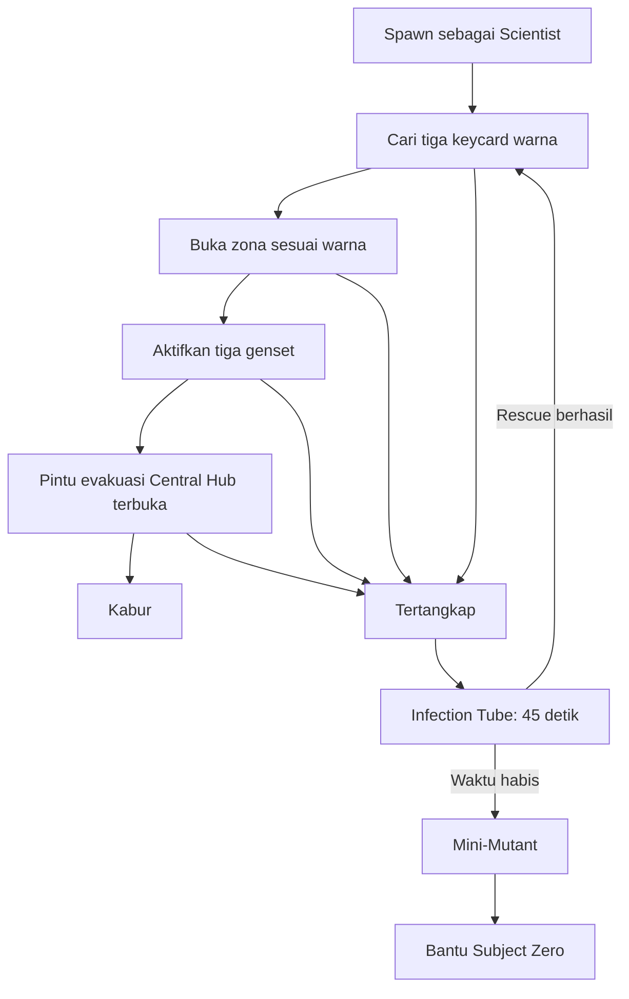
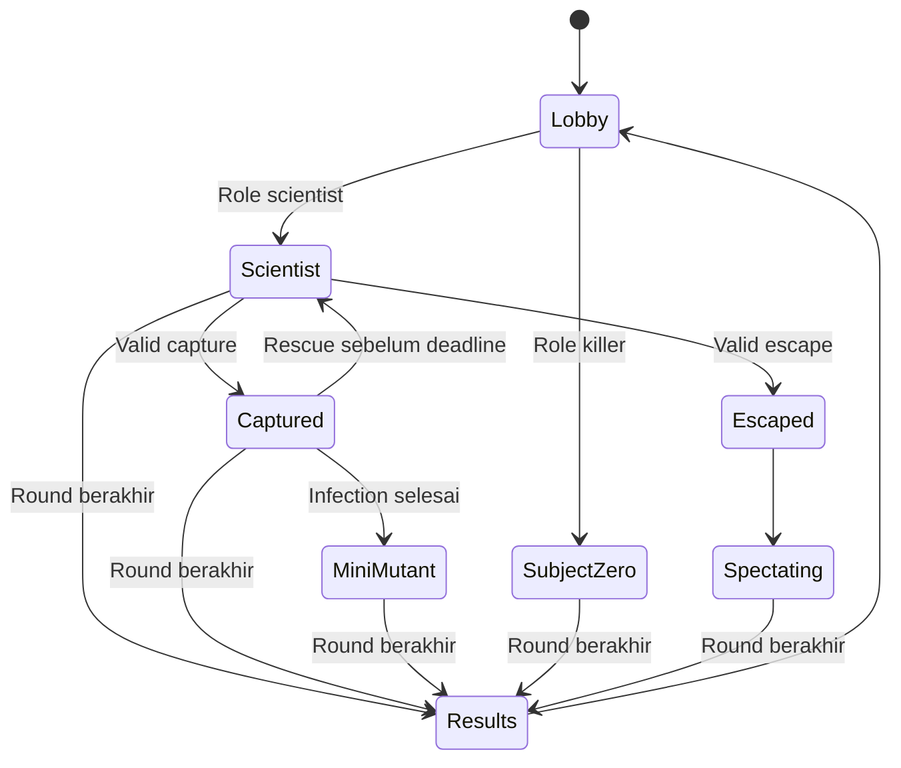
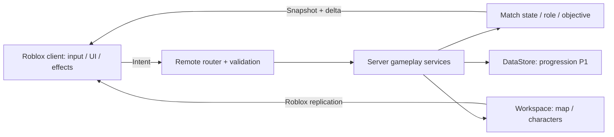

# ESCAPE THE LAB (ETL)

> **Master Game Design Document + Technical Design Document**  
> Roblox • Asymmetrical Survival Horror • Multiplayer  
> **Tagline:** Escape together. Or become the threat.

| Metadata | Keterangan |
|---|---|
| Judul | Escape the Lab (ETL) |
| Versi dokumen | v0.2 — Spesifikasi pre-production |
| Tanggal | 27 November 2026 |
| Konsep awal | Fathan Dzaki (berdasarkan GDD yang dibagikan) |
| Inisiatif kolaborasi | Komunitas Hammad Studio (usulan) |
| Target platform | Roblox, PC & Mobile |
| Genre | Asymmetrical Survival, Infection, Horror-lite |
| Target pemain MVP | 1–7 pemain per server. Latihan 1–2, ronde pendek 3, ronde utama 4–7. Target balance utama 1 Subject Zero vs 6 Scientists. |
| Status | Pre-production; belum diimplementasikan / diuji |

**Cara membaca dokumen.** **[BASE]** berasal dari konsep awal. **[PROPOSAL]** menandai pengembangan tim. §9.0, §9.2, dan profil map §8.6 menetapkan baseline implementasi v0.2. Angka prototipe tetap hipotesis playtest. Blueprint ini merupakan rancangan top-down tekstual.

## Daftar isi

1. [Visi produk](#1-visi-produk)
2. [Game pillars dan target pemain](#2-game-pillars-dan-target-pemain)
3. [Lore dan atmosfer](#3-lore-dan-atmosfer)
4. [Core gameplay loop](#4-core-gameplay-loop)
5. [Faksi, karakter, dan balancing](#5-faksi-karakter-dan-balancing)
6. [Objective dan interaksi](#6-objective-dan-interaksi)
7. [Infection dan rescue system](#7-infection-dan-rescue-system)
8. [Map design blueprint](#8-map-design-blueprint)
9. [Match flow dan edge cases](#9-match-flow-dan-edge-cases)
10. [UI/UX dan kontrol](#10-uiux-dan-kontrol)
11. [Art direction dan audio](#11-art-direction-dan-audio)
12. [Progression dan monetisasi](#12-progression-dan-monetisasi)
13. [Technical Design Document](#13-technical-design-document)
14. [Keamanan, performa, dan QA](#14-keamanan-performa-dan-qa)
15. [Pembagian tim dan workflow](#15-pembagian-tim-dan-workflow)
16. [Roadmap dan backlog MVP](#16-roadmap-dan-backlog-mvp)
17. [Playtest dan success metrics](#17-playtest-dan-success-metrics)
18. [Risiko dan keputusan terbuka](#18-risiko-dan-keputusan-terbuka)
19. [Referensi](#19-referensi)

---

## 1. Visi produk

### 1.1 High concept [BASE]

Sekelompok ilmuwan terjebak di fasilitas laboratorium setelah sebuah eksperimen gagal. Mereka harus menemukan tiga keycard, membuka zona yang sesuai, mengaktifkan tiga genset, dan melarikan diri melalui pintu evakuasi di tengah map. Satu pemain berperan sebagai Subject Zero yang berusaha menangkap dan menginfeksi mereka semua.

### 1.2 Unique selling proposition

**Kekalahan bukan akhir permainan, tetapi awal peran yang baru.**

Pemain yang tertangkap dimasukkan ke Infection Tube. Rekan satu tim dapat menyelamatkannya sebelum waktu habis. Jika gagal, pemain tersebut berubah menjadi Mini-Mutant dan ikut memburu Scientists yang sebelumnya menjadi rekannya.

Dengan begitu, ETL menggabungkan pengejaran, kerja sama, manajemen risiko, dan perubahan faksi secara dinamis. Match yang dimulai sebagai 1 vs 6 dapat berakhir sebagai 5 vs 2 atau bahkan 6 vs 1.

### 1.3 Positioning [PROPOSAL]

- Mudah dipahami dalam satu match, tetapi sulit dikuasai secara taktis.
- Horror yang mengandalkan atmosfer, audio, dan ketegangan, bukan gore.
- Cocok untuk momen lucu, panik, pengkhianatan karena infeksi, serta konten pendek kreator Roblox.
- Prioritaskan pengalaman multiplayer yang stabil dibanding banyak map atau fitur kosmetik pada versi pertama.

## 2. Game pillars dan target pemain

| Pillar | Implementasi |
|---|---|
| **Nobody sits out early** | Scientist yang tertangkap dapat diselamatkan atau melanjutkan sebagai mutant. Pemain yang sudah kabur menjadi spectator hingga match selesai. |
| **Teamwork under pressure** | Pemain harus membagi tugas antara mencari kartu, menyalakan genset, dan menyelamatkan teman. |
| **Escalating threat** | Subject Zero semakin cepat setelah genset aktif; jumlah mutant juga dapat meningkat. |
| **Meaningful counterplay** | Ventilasi, rute alternatif, suara ancaman, dan batas kemampuan mutant memberi kesempatan melawan secara taktis. |
| **Readable chaos** | Warna zona, simbol, HUD, dan audio membantu pemain memahami situasi walau sedang dikejar. |

Target: pemain Roblox yang menyukai survival multiplayer, horror-lite, dan bermain bersama teman. Tidak diperlukan pengetahuan game horror sebelumnya. UI dan kontrol harus dapat digunakan di HP, bukan hanya PC.

## 3. Lore dan atmosfer

**[PROPOSAL]** Fasilitas bawah tanah dengan nama sementara **Facility 07** mengembangkan proyek regenerasi biologis. Eksperimen Subject Zero lepas kendali, sistem listrik utama mati, dan protokol karantina mengunci akses keluar. Scientists yang tersisa harus memulihkan suplai energi sebelum fasilitas memasuki lockdown total.

Identitas Subject Zero dan detail eksperimen dapat disampaikan melalui catatan penelitian, layar rusak, dan pesan interkom. Lore tidak boleh memperlambat gameplay. Gunakan cerita lingkungan daripada cutscene panjang.

- Red Sector: penelitian dan keamanan.
- Blue Sector: cryogenics dan kontrol sistem.
- Green Sector: biohazard dan containment.
- Central Hub: pusat kendali dan evakuasi.

Nama-nama fasilitas ini bersifat sementara.

## 4. Core gameplay loop

### 4.1 Scientist [BASE]



Diagram menyederhanakan alur: Scientist dapat mengerjakan ketiga zona secara paralel dan kembali ke objective yang masih tersisa setelah rescue; progres tim tidak direset.

### 4.2 Subject Zero [BASE]

Patroli zona → cari Scientist → kejar dan tangkap → masukkan ke Infection Tube → putuskan apakah akan mengganggu rescue atau menjaga objective → gunakan System Lockdown → manfaatkan mutant yang terinfeksi untuk memberi tekanan.

### 4.3 Ketegangan per fase [PROPOSAL]

| Fase | Pengalaman yang diinginkan |
|---|---|
| Awal | Eksplorasi, mencari kartu, mengenali rute, ancaman mulai terdengar. |
| Tengah | Genset aktif, rescue terjadi, tim mulai berpencar atau bekerja sama. |
| Akhir | Subject Zero paling kuat, mutant mungkin bertambah, perlombaan menuju evakuasi. |

Contoh: dua Scientist memperbaiki genset biru, satu mengambil keycard hijau, dan satu membebaskan temannya. Subject Zero harus memilih antara menjaga objective atau mengejar pemain yang mencoba rescue. Tidak ada peran yang diwajibkan secara permanen dalam MVP.

## 5. Faksi, karakter, dan balancing

### 5.1 Scientists

- **[BASE]** Objektif: keycard, buka zona, aktifkan genset, evakuasi, rescue teman.
- **[PROPOSAL]** Semua Scientist menggunakan kemampuan dasar yang sama pada MVP agar balancing tidak terlalu kompleks.
- Dapat sprint, menggunakan ventilasi, berinteraksi dengan objective dan membantu rescue.
- Tidak mempunyai senjata mematikan. Bertahan dengan pergerakan, koordinasi dan penggunaan layout.

### 5.2 Subject Zero

**[BASE] Adrenaline Rush (pasif):** kecepatan lari bertambah 5% setiap kali satu genset aktif.

**[PROPOSAL]** Gunakan bonus aditif terhadap kecepatan dasar: `baseSpeed × (1 + 0.05 × activeGenerators)`. Maksimum +15% setelah tiga genset. Perhitungan aditif merupakan interpretasi desain, belum ditetapkan di sumber awal.

**[BASE] System Lockdown (aktif):** mengunci satu pintu zona warna dari jarak jauh selama 10 detik, cooldown 45 detik.

**[PROPOSAL]** Pilih warna melalui tombol atau radial menu. Pintu yang terkena skill berkedip dan menampilkan countdown. Skill hanya menargetkan pintu zona yang sudah terbuka; ventilasi dan pintu evakuasi tidak dapat dikunci. Skill gagal tanpa memakai cooldown jika target tidak valid. Cooldown dimulai saat efek berhasil diaktifkan.

### 5.3 Mini-Mutant

- **[BASE]** Scientist yang gagal diselamatkan beralih ke tim killer, dengan pergerakan lebih lambat daripada Subject Zero.
- **[PROPOSAL]** Tidak mempunyai System Lockdown, tidak bisa menggunakan ventilasi, dan tidak memperoleh Adrenaline Rush.
- Untuk mengurangi snowball, mutant tidak bisa menangkap langsung. Serangannya memberi efek slow singkat dan menandai target secara lokal sehingga Subject Zero bisa mendekat. Hanya Subject Zero yang dapat melakukan final capture pada MVP.
- Efek slow tidak menumpuk, dan target yang sama menerima kekebalan singkat dari slow ulang.
- Mutant mengikuti hasil faksi Killer sesuai §9.2.

> Keputusan penting: apakah mutant boleh melakukan capture sendiri? GDD awal hanya menyebut tugas mengejar. Pembatasan di atas adalah usulan konservatif supaya infeksi pertama tidak otomatis menentukan hasil pertandingan.

### 5.4 Tabel parameter awal [PROPOSAL, kecuali bertanda BASE]

| Parameter | Nilai prototipe | Catatan |
|---|---:|---|
| Scientist walk speed | 16 studs/s | Gerakan normal |
| Scientist sprint speed | 22 studs/s | Dibatasi stamina |
| Stamina | 100 | Sprint menghabiskan 20/s; pulih 15/s setelah 1,5 s |
| Subject Zero base speed | 19 studs/s | Tanpa sprint tambahan |
| Speed setelah 1/2/3 genset | 19,95 / 20,90 / 21,85 | Formula bonus aditif 5% [BASE: bonus] |
| Mini-Mutant speed | 17,5 studs/s | Selalu di bawah Subject Zero |
| Subject Zero capture range | 5 studs | Jarak dan line-of-sight diverifikasi server |
| Capture cooldown | 3 s | Mulai setelah capture berhasil dicatat |
| Mutant attack range | 4 studs | Perlu dekat |
| Mutant slow | 20% selama 2 s | Kekebalan slow ulang 5 s setelah efek berakhir |
| Mutant attack cooldown | 6 s | Tidak stack |
| Infection timer | 45 s | [BASE] |
| Rescue hold | 3 s | [BASE] |
| Rescue protection | 3 s | Tidak dapat ditangkap ulang; tidak mengerjakan objective |
| Lockdown duration / cooldown | 10 s / 45 s | [BASE] |
| Match duration | 10 menit | Termasuk fase evakuasi, dapat berubah saat playtest |

Semua nilai diletakkan dalam konfigurasi, bukan hardcoded pada banyak script. Speed Roblox di atas adalah target prototipe, bukan hasil simulasi fisik atau playtest.

## 6. Objective dan interaksi

### 6.1 Keycard system

**[BASE]** Tiga keycard (merah, biru, hijau) membuka pintu zona dengan warna yang sama.

**[PROPOSAL]** Agar kartu tidak hilang saat pemain terinfeksi atau disconnect:

- Setiap warna memiliki minimal 3 titik spawn yang telah divalidasi dapat dicapai tanpa kartu.
- Server memilih satu titik untuk tiap warna setiap match. Titik spawn tidak boleh bertumpuk.
- Setelah diambil, kartu menjadi akses bersama tim. HUD memperbarui status kartu untuk semua Scientist. Tidak perlu menyerahkan item antar pemain.
- Pintu dapat dibuka oleh Scientist mana pun setelah kartu diperoleh; pintu tetap terbuka hingga terkena Lockdown sementara.
- Tidak ada keycard yang hanya bisa diperoleh setelah membuka zona yang bergantung pada kartu tersebut.

### 6.2 Generator system

**[BASE]** Satu genset di ujung masing-masing zona. Pada map penuh, tiga genset wajib aktif untuk evakuasi.

**[PROPOSAL]** Pada MVP, gunakan interaksi perbaikan sederhana:

1. Dekati genset, tahan tombol interaksi. Target awal: 12 detik total.
2. Progres bertahan jika pemain meninggalkan genset, sehingga teman dapat melanjutkan.
3. Maksimum dua pemain membantu satu genset; pemain kedua menambah 50% laju perbaikan, bukan 100%.
4. Server menghentikan kontribusi saat pemain menjauh, tertangkap, terinfeksi, atau kehilangan koneksi.
5. Setelah mencapai 100%, genset aktif permanen untuk match tersebut.
6. Semua pemain mendapat umpan balik audio/visual. Subject Zero mendapat bonus speed.

Skill check berbasis timing, sabotage, dan blackout dinamis masuk post-MVP agar objective utama stabil terlebih dahulu.

### 6.3 Evacuation gate

- **[BASE]** Pintu evakuasi berada di Central Hub dan tersedia setelah ketiga genset aktif pada map penuh.
- **[PROPOSAL]** Gerbang terbuka otomatis setelah animasi 5 detik. Setiap Scientist dapat kabur secara individual dengan melintasi escape trigger yang divalidasi server.
- Pemain yang kabur tidak dapat kembali membantu tim, tetapi dapat menonton Scientist yang masih aktif atau menunggu hasil di area aman.
- Gate memiliki satu tujuan akhir dengan beberapa pendekatan dan cover. Server membuka gate setelah semua genset pada profil aktif selesai (satu atau tiga sesuai §9.0).
- Escape pertama memastikan hasil faksi Scientist. Pemain lain bisa melanjutkan sesuai aturan akhir ronde §9.2.

## 7. Infection dan rescue system

### 7.1 Capture [BASE + PROPOSAL]

Saat Subject Zero berhasil menangkap Scientist, korban langsung dimasukkan ke Infection Tube. Untuk MVP, gunakan pemindahan yang dilakukan server menuju tabung bebas terdekat, dengan transisi visual singkat. Tidak ada sistem gendong/HP/downed tambahan pada MVP. Ini menyederhanakan networking dan menghindari menunggu animasi panjang.

- Satu tabung menampung satu pemain.
- Pilih tabung valid yang kosong dengan jarak lurus terkecil dari posisi korban, lalu `TubeId` terkecil jika seri. Semua tabung aktif harus bisa dicapai dari hub sebelum kartu pertama diambil dan saat Lockdown. Jika tidak ada tabung valid, tolak capture, pertahankan state korban dan cooldown, lalu log error.
- Server mencatat penempatan korban, status `Captured`, deadline infeksi dan cooldown capture sebagai satu perubahan gameplay. Transisi visual mengikuti perubahan itu.
- Pemain yang tertangkap melihat timer dan dapat menggunakan ping rescue terbatas.
- Scientist aktif mendapatkan indikator lokasi tabung dan sisa waktu korban.
- Timer tetap berjalan jika Subject Zero pindah zona.

### 7.2 Rescue [BASE]

Scientist lain mendekati tabung, menahan E selama 3 detik (atau tombol touch), dan melepaskan korban sebelum 45 detik berakhir.

**[PROPOSAL]** Rescue batal saat penolong menjauh, tertangkap, atau melepas input. Progres rescue direset saat batal. Jika dua penolong berinteraksi, hanya satu yang dapat menyelesaikan rescue; keduanya tidak mempercepat durasi. Setelah bebas, korban mendapat proteksi capture 3 detik dan tidak bisa mengerjakan objective saat proteksi berlangsung.

### 7.3 Mutation [BASE + PROPOSAL]

Jika waktu habis, server mengubah role korban menjadi Mini-Mutant, melepas tabung, menghapus hak akses Scientist, mengganti HUD dan kemampuan, serta memindahkan pemain ke titik aman sekitar tabung. Pemain tetap berada pada match yang sama. Proses dibuat atomik agar tidak terjadi rescue dan mutation bersamaan.

Aturan tie: rescue sah hanya apabila penyelesaian hold di server terjadi **sebelum** deadline infeksi; jika tepat pada deadline, mutation menang. Jangan gunakan timer lokal sebagai sumber kebenaran.

### 7.4 Anti-camping

- Tabung tersebar di lokasi dengan minimal dua pendekatan dan cover.
- Jangan membuat tabung berada tepat di sebelah genset atau gerbang evakuasi.
- P0 menguji layout dan countdown tetap 45 detik. Jika pemain masih konsisten gagal mencapai tabung karena camping, eksperimen P1 dapat memperlambat countdown menjadi 50% setelah 8 detik Subject Zero berada dalam radius 12 studs tanpa Scientist aktif lain di radius itu, dengan tambahan maksimum 15 detik per episode capture. Tampilkan efek aktif dan kembali ke laju normal saat kondisi berakhir.

### 7.5 Player state diagram



Disconnect adalah transisi terpisah dari setiap state aktif, dijelaskan pada bagian match flow.

## 8. Map design blueprint

### 8.1 Layout [BASE]

Konsep Hub & Spoke: satu Central Hub, tiga cabang zona warna, genset di ujung zona, dan jalur ventilasi yang menghubungkan zona sebagai rute alternatif Scientist. Referensi visual awal memperlihatkan ruangan melingkar gelap dengan struktur sentral dan pencahayaan hijau industrial (atribusi pada gambar: D&M Production). Gunakan sebagai inspirasi atmosfer, bukan asset yang diasumsikan bebas digunakan.

### 8.2 Top-down schematic [PROPOSAL]

```text
                          NORTH / RED
               +---------------------------+
               | Research    Security      |
               |          [G-R]            |
               | V-RB   Loop R       V-RG  |
               +-----------[D-R]-----------+
                            ||
                      Research Corridor [T1/T2]
                            ||
        (vent RB) . . .     ||     . . . (vent RG)
                 .    +---------------+    .
                 .    |   CENTRAL HUB |    .
                 .    |  cover  EXIT  |    .
                 .    | alcoves [T3]  |    .
                 .    +--+---------+--+    .
                 .     [T4]       [T5/T6]  .
                 .       /         \       .
                 .     D-B         D-G     .
                 .     /             \     .
   +-------------+----+               +----+-------------+
   | V-BR    Loop B   |               | Loop G     V-GR  |
   |      [G-B]       |               |      [G-G]      |
   | Cryo / Control   |               | Bio / Containment|
   |          V-BG    |               | V-GB             |
   +-------------+----+               +----+-------------+
                 .                         .
                 . . . . vent BG . . . . . .
         SOUTHWEST / BLUE              SOUTHEAST / GREEN
```

Legenda: `G` generator, `D` pintu warna, `T` Infection Tube, `V` akses ventilasi. Garis titik-titik menunjukkan ventilasi. Hub dan lorong sebelum pintu warna membentuk jalur publik. Beri tiap tabung alcove dan cover tersendiri. Tempatkan T3 di tepi hub, terpisah dari alcove spawn, jalur utama gate, dan trigger evakuasi.

### 8.3 Ruangan dan landmark

| Area | Ruangan | Tujuan gameplay | Identitas visual |
|---|---|---|---|
| Central Hub | Evacuation, security desk, reception alcoves | Orientasi, spawn Scientists, akses antarzona, evakuasi | Ruang melingkar, pilar, lampu putih/hijau, emergency shutter |
| Red | Research, security, power room | Objective merah, chase loop | Merah, amber, simbol segitiga, rak dan meja riset |
| Blue | Cryo storage, control, power room | Objective biru, cover rapat | Biru, simbol persegi, mesin pendingin, kaca buram |
| Green | Containment, specimen room, power room | Objective hijau, chase loop | Hijau, simbol lingkaran, tabung spesimen, pipa |
| Vent | RB, RG, BG | Rute kabur dan rotasi Scientist | Logam, lampu rendah, suara ventilasi |

### 8.4 Blockout dimensions

| Elemen | Target awal |
|---|---|
| Footprint total | Sekitar 280 × 280 studs; skala dapat berubah |
| Central Hub | Diameter sekitar 60 studs |
| Lorong utama | Lebar 12–16 studs |
| Lorong samping | Lebar 8–12 studs |
| Ruang genset | Sekitar 24 × 24 studs |
| Tinggi ruang | 12–18 studs |
| Vent | Entrance berinteraksi, terhubung dengan jalur transit khusus |
| Waktu hub ke genset | Target 8–15 detik lari normal tanpa hambatan; ukur pada blockout |
| Waktu rotasi vent antarzona | Target 6–9 detik setelah kedua zona terkait terbuka |

Gunakan `studs` sebagai unit pengukuran Roblox. Target waktu dan dimensi adalah hipotesis, bukan ukuran map referensi.

### 8.5 Routing rules dan spawn

- Setiap zona mempunyai setidaknya satu loop pengejaran. Setiap tabung publik punya dua pendekatan layak dari percabangan publik dengan cover.
- Vent baru dapat digunakan jika kedua zona yang dihubungkan sudah terbuka secara permanen oleh keycard. Lockdown sementara tidak menonaktifkan vent tersebut.
- MVP vent menggunakan interaksi masuk 1 detik, transit 4–6 detik, lalu server menempatkan pemain di exit. Jangan gunakan teleport seketika untuk menghindari chase yang terlalu mudah. Cooldown vent per pemain 8 detik setelah keluar.
- Sediakan 6 spawn Scientist tersebar di alcove hub yang dapat dicapai tanpa kartu; spawn Subject Zero di security annex terpisah yang punya jalur ke hub. Berikan head start Scientist 12 detik sebelum killer dapat bergerak.
- Keycard kandidat berada di hub atau koridor publik sebelum pintu zona. Awal match tidak boleh memiliki objective yang mustahil diakses.
- Letakkan cover di sekitar gate agar killer tidak bisa mengawasi semua pendekatan sekaligus. Uji camp di gate dengan 1–3 mutant aktif. Jika terlalu kuat, desain ulang gate menjadi area escape lebih lebar atau dua entrance menuju satu tujuan evakuasi.

### 8.6 Map object contract

Map builder memberi nama/atribut/tag sesuai kontrak yang disepakati programmer. ID stabil antar match, tidak tergantung nama dekorasi.

| Tag | Attributes wajib | Satu zona | Tiga zona |
|---|---|---:|---:|
| `ScientistSpawn` | `SpawnId` | 3 | 6 |
| `KillerSpawn` | `SpawnId` | 1 | 1 |
| `KeycardSpawn` | `SpawnId`, `Color` | 3 | 9 |
| `ZoneDoor` | `ZoneId` | 1 | 3 |
| `Generator` | `ZoneId`, `ObjectiveId` | 1 | 3 |
| `InfectionTube` | `TubeId`, `AreaId` | 3 | 6 |
| `VentEntrance` | `VentId`, `ZoneId`, `LinkedVentId` | 0 | 6 |
| `EvacuationGate` | `GateId` | 1 | 1 |
| `EscapeTrigger` | `GateId` | 1 | 1 |

Latihan, ronde pendek, dan M1 memakai profil satu zona (Red), dengan spawn Scientist `S1`–`S3` dan tabung `T1`–`T3`. M1 menguji maksimal empat pemain. Ronde utama M2 memakai tiga zona, `S1`–`S6` dan `T1`–`T6`. Kedua profil memakai spawn Subject Zero dan pasangan gate/trigger yang sama. Tutup cabang di luar profil secara fisik. Daftarkan ke lookup server hanya ID profil aktif dan objek yang warna atau `ZoneId`-nya aktif. Vent hanya aktif pada profil tiga zona. `AreaId` tabung menunjuk landmark publik yang tampil di HUD, misalnya `ResearchCorridor`.

Sebelum spawn, validator memeriksa jumlah objek dan ID unik untuk setiap tag. `GateId` yang sama harus menghubungkan gate dan trigger, dan `ZoneId` yang sama menghubungkan pintu dan genset. Periksa juga tiga kandidat kartu per warna dan pasangan vent dua arah bila dipakai. Jika gagal, kembali ke lobby dan log objek yang bermasalah. QA blockout memastikan kartu, tabung dan jalur rescue dapat dicapai saat seluruh pintu zona tertutup.

## 9. Match flow dan edge cases

### 9.0 Mode dan transisi pemain

| Pemain siap | Mode | Tujuan dan batas prototipe |
|---|---|---|
| 1 | Latihan solo | Satu zona. Ambil keycard, buka pintu, nyalakan genset dan kabur. Panduan kontekstual mengikuti langkah berikutnya. |
| 2 | Latihan co-op | Satu zona. Dua Scientist mulai bersama. Saat pintu pertama terbuka, server satu kali memasukkan pemain yang membukanya ke tabung publik. Rekannya mengikuti penanda dan mencoba rescue. Genset baru dapat dikerjakan setelah rescue. Keduanya harus melewati gate untuk menyelesaikan latihan. Jika timer infeksi habis, tampilkan penjelasan mutasi dan akhiri latihan agar bisa diulang. |
| 3 | Ronde pendek | 1 Subject Zero vs 2 Scientist, satu zona, batas awal 5 menit. Capture, rescue, mutasi dan escape memakai aturan kompetitif. |
| 4–7 | Ronde utama | 1 Subject Zero vs 3–6 Scientist, tiga zona, batas awal 10 menit. M1 menguji 4 pemain memakai profil satu zona sebelum map penuh tersedia. |

- Sejak M1, ronde kompetitif memakai capture langsung, Adrenaline Rush +5% per genset, dan Mini-Mutant dengan slow. System Lockdown dan vent hanya aktif pada profil tiga zona, mulai M2. Latihan memakai kontrol Scientist dan interaksi yang sama.
- Lobby berada di luar arena. Pemain siap dapat menekan `Mulai Latihan` saat arena kosong dan ada satu atau dua pemain siap. Jika dua pemain siap, minta persetujuan pemain kedua sebelum keduanya dipindahkan ke arena. Jika belum disetujui, pemohon bisa mulai solo. Pemain yang datang saat sesi berjalan bisa ikut latihan berikutnya. Latihan berjalan maksimal 120 detik dan bisa ditinggalkan kapan saja. Jika salah satu peserta keluar dari co-op, akhiri sesi dengan opsi mulai ulang.
- Pemain yang baru masuk lobby otomatis siap mengikuti ronde. Status siap bisa diubah selama menunggu, intermission, atau berlatih. Masuk latihan mempertahankan status siap. Saat tiga pemain siap, tampilkan status ronde siap dan hentikan start latihan baru. Peserta latihan yang siap boleh memilih `Ikut Ronde`, yang mengakhiri keikutsertaannya di latihan sambil tetap siap, atau menyelesaikan latihan aktif. Jika co-op berakhir karena rekannya pindah ke ronde, beri tahu pemain yang tersisa. Mulai intermission setelah arena kosong dan pemain siap masih memenuhi minimum.
- Jika pemain siap turun di bawah tiga selama intermission, kembali ke `Waiting`. Di akhir intermission, ambil daftar pemain siap dan kunci peserta serta mode saat `Preparing`. Jika peserta terputus saat persiapan, batalkan persiapan, bersihkan arena dan kembali ke `Waiting` untuk memilih ulang roster dan mode. Pemain yang masuk setelah roster dikunci menunggu ronde berikutnya. Perubahan jumlah pemain saat `Active` mengikuti §9.4 dan tidak mengubah profil atau jumlah genset.
- Satu server memiliki satu sesi arena aktif sekaligus. Latihan dan ronde memakai reset map, interaksi, dan HUD yang sama. Latihan punya ID sesi sendiri, hanya menerima aksi dari pesertanya, dan tidak mengubah statistik kompetitif, bobot role, atau reward.

### 9.1 Round lifecycle [PROPOSAL]

| State | Durasi awal | Perilaku |
|---|---:|---|
| `Waiting` | Dinamis | Latihan tersedia di bawah 3 pemain siap. Pada 3 atau lebih, tunggu arena kosong lalu mulai intermission. |
| `Intermission` | 20 s | Pemain siap, server memeriksa map. |
| `Preparing` | 5 s | Reset round, assign roles, spawn, tutorial singkat. |
| `Active` | 300 s / 600 s | Ronde pendek / utama. Waktu berjalan sejak awal gameplay termasuk head start. |
| `Results` | 12 s | Tampilkan hasil individu dan faksi, XP jika fitur tersedia. |
| `Cleanup` | Sesingkat mungkin | Bersihkan task, connection, state, map, lalu ke Waiting. |

Evakuasi adalah substate `GateOpen` dalam Active, bukan round baru; timer tetap berjalan. Tidak ada overtime pada MVP. Jika semua Scientist sudah kabur, terinfeksi, atau keluar sebelum waktu habis, selesaikan round lebih awal. Scientist dalam tabung masih dihitung sebagai belum terselesaikan hingga mutasi, rescue, atau round timeout.

### 9.2 Win conditions

Pada ronde kompetitif, server mencatat escape yang sah sebelum deadline. Begitu tercatat, escape tetap berlaku meskipun pemain keluar. Sebelum menerapkan aksi atau disconnect, server memeriksa deadline. Jika sudah tercapai, hasil timeout memakai state terakhir yang sah. Sebelum deadline, evaluasi hasil setelah setiap escape, mutasi, atau disconnect. Selesaikan hasil satu kali dengan aturan berikut.

1. Jika Subject Zero keluar saat `Active`, selesaikan kemenangan Scientist bila escape sudah tercatat. Jika belum, batalkan ronde.
2. Jika tidak ada Scientist aktif atau tertangkap, selesaikan kemenangan Scientist bila sudah ada escape. Tanpa escape, mutasi Scientist terakhir memberi kemenangan Killer, sementara disconnect Scientist terakhir membatalkan ronde. Disconnect Scientist sebelumnya tidak menghalangi kemenangan dari mutasi terakhir. Mutant yang keluar tetap tercatat pernah bermutasi.
3. Jika deadline tiba dengan Scientist aktif atau tertangkap, Scientist menang bila ada escape. Jika tidak, Killer menang. Aksi yang diterima tepat pada deadline atau setelahnya tidak mengubah hasil.

Scientist mendapat kemenangan individu lewat escape. Mini-Mutant mewarisi hasil Killer. Scientist yang belum kabur kalah secara individu meskipun faksinya menang. Ronde berlanjut setelah escape pertama selama masih ada Scientist aktif atau tertangkap dan Subject Zero masih bermain. Results menampilkan outcome, escape, mutasi, rescue, dan genset aktif. Ronde batal tidak memberi reward kompetitif.

### 9.3 Role selection

Pilih killer di server menggunakan bobot yang meningkat untuk pemain yang belum mendapatkan role tersebut. Jangan menjual kesempatan killer pada MVP. Tawarkan opsi preferensi role post-MVP, bukan role yang dipastikan setiap saat.

### 9.4 Edge cases

| Kasus | Penanganan |
|---|---|
| Scientist keluar | Lepaskan kontribusi genset, tube, dan state miliknya; kartu yang sudah diambil tetap milik tim. |
| Captured player disconnect | Kosongkan tabung; tidak melahirkan mutant bot. |
| Mutant keluar | Bersihkan effect, slot, dan koneksi. |
| Subject Zero keluar | Akhiri ronde sesuai §9.2 dan tampilkan alasan hasilnya. |
| Scientist aktif/captured terakhir keluar | Catat disconnect dan evaluasi hasil sesuai §9.2 setelah slot dan interaksinya dibersihkan. |
| Join ketika match aktif | Lobby/spectator tanpa ikut round yang sedang berjalan. |
| Reset character / jatuh keluar map | Role tidak berubah. Server pulihkan ke titik valid sesuai role; cegah reset menjadi cara keluar dari tabung. |
| Rescue vs mutation pada waktu sama | Server memutuskan dari deadline; mutation pada waktu yang sama. |
| Lockdown vs gate open | Hanya pintu zona bisa dikunci; gate tetap berfungsi. |
| Dua pemain mengambil kartu sama | Server menandai acquired secara atomik, reward sekali. |
| Timer habis saat escape berlangsung | Hanya escape yang tercatat server sebelum deadline dianggap sah. |

## 10. UI/UX dan kontrol

### 10.1 Screen flow

```text
Launch → Lobby → Intermission → Role Reveal → In-game HUD → Results → Lobby
                                    |              |
                                    |              +-- Captured HUD → Rescue / Mutant HUD
                                    |              +-- Escaped → Spectator HUD
                                    +-- Tutorial ringkas sesuai role
```

### 10.2 Lobby

- Logo ETL, jumlah pemain siap, status ronde berikutnya, tombol `Siap`, dan settings. Saat syarat §9.0 terpenuhi, tampilkan `Mulai Latihan`. Jika ronde siap saat pemain berlatih, tampilkan `Ikut Ronde` tanpa menutup latihan mendadak.
- Gunakan lobby sederhana berbentuk ruang briefing laboratorium.
- Tampilkan status matchmaking lokal, countdown saat cukup pemain, dan informasi role secara jelas.
- Jangan membuat inventory shop, battle pass, atau matchmaking lintas server sebelum game loop terbukti menarik.

### 10.3 Scientist HUD

```text
+-----------------------------------------------------+
| ETL       GENERATORS  1/3              TIME  06:42   |
|          R: ON  B: REPAIR  G: LOCKED                 |
|                                                     |
|     RESCUE: Green Sector — Scientist 04: 00:27       |
|                                                     |
|                 [ E ] REPAIR GENERATOR              |
|                      █████░░░  62%                  |
|                                                     |
| Stamina ███████░░░                      [SPRINT]    |
+-----------------------------------------------------+
```

Status warna selalu disertai huruf, ikon atau teks. UI tidak boleh mengandalkan merah/hijau saja. Peringatan rescue memakai lokasi zona, ikon tabung, dan countdown. Objective tracker menampilkan tahap keycard → pintu → genset → escape.

### 10.4 Killer HUD

- Timer, jumlah Scientist aktif / captured / escaped / mutant.
- Adrenaline Rush multiplier (contoh `+10%`).
- System Lockdown: tiga pilihan warna, cooldown, kondisi pintu.
- Crosshair/indikator capture jika target berada dalam jangkauan secara perkiraan; keputusan akhir tetap di server.
- Tidak ada wallhack lokasi semua Scientist permanen.

### 10.5 Captured, mutant, dan results

Captured HUD menampilkan `INFECTION IN PROGRESS`, countdown besar, dan aksi ping. Pada ronde kompetitif, HUD menjelaskan mutasi akan memberi peran Mini-Mutant, lalu menampilkan slow dan cooldown setelah berubah. Pada latihan co-op, tampilkan instruksi penolong dan hasil latihan sesuai §9.0. Results ronde memisahkan outcome faksi dan status individu. Pemain kembali ke lobby setelah results dan dapat mengatur status `Siap` untuk sesi berikutnya.

### 10.6 Input mapping [PROPOSAL]

| Action | PC | Mobile |
|---|---|---|
| Move / camera | WASD / mouse | Virtual thumbstick / swipe |
| Sprint | Shift | Tombol sprint toggle |
| Interact / rescue | E / tahan E | Contextual hold button |
| Capture / mutant attack | Klik kiri | Tombol attack |
| Lockdown | Q → pilih zona | Skill button → pilih zona |
| Ping rescue | R (captured) | Tombol ping |
| Settings | Escape / menu Roblox + UI custom | Ikon settings |

Gunakan `ProximityPrompt` sebagai dasar tampilan interaksi dunia bila sesuai, dengan UI yang responsif untuk touch dan keyboard. Jika diperlukan custom action, ikat input sesuai perangkat. Hindari tombol menutupi joystick dan area kamera. Uji di HP fisik, bukan hanya emulator Studio.

## 11. Art direction dan audio

### 11.1 Style guide

**Arah visual [PROPOSAL]:** stylized industrial sci-fi horror; bentuk modular, low-to-medium poly, siluet kuat, tekstur sederhana, kontras yang terbaca di layar HP. Ruang gelap tetapi navigasi tetap jelas. Kamera third-person, tanpa jumpscare ekstrem.

| Elemen | Palet / identitas |
|---|---|
| Base | Charcoal `#101719`, steel `#28363A`, concrete `#667477` |
| Red | `#EF4444`, simbol segitiga |
| Blue | `#60A5FA`, simbol persegi |
| Green | `#4ADE80`, simbol lingkaran |
| Evacuation | `#FBBF24`, ikon exit |
| Text/HUD | `#E5E7EB` pada latar gelap |

Gunakan warna sebagai aksen landmark, bukan membanjiri seluruh ruangan. Lampu overhead, pipa, panel pintu, signage, serta lantai modular membangun konsistensi. Efek kedip dan camera shake harus dapat dikurangi/dimatikan.

### 11.2 Asset list minimum

| Prioritas | Asset |
|---|---|
| P0 | Modular wall/floor/ceiling, 3 pintu zona, gerbang evakuasi, 3 genset, 3 keycard, 6 tabung, entrance vent, cover props |
| P0 | Subject Zero rig dan Mini-Mutant rig; idle, walk, run, attack, capture/mutation feedback |
| P0 | Scientist avatar standar dengan animasi interaksi |
| P1 | Emergency light, signage, desk, pipe, rack, monitor, cryo props, specimen props |
| P1 | Logo, role icons, objective icons, UI textures |
| P2 | Skin karakter, lore collectible, cinematic intro, dekorasi tambahan |

Gunakan asset original atau asset dengan lisensi yang mengizinkan penggunaan di Roblox. Catat pembuat, URL, izin, dan file sumber di `ASSET_CREDITS.md`. Jangan menyalin map/karakter dari game lain secara langsung.

### 11.3 Audio plan

- Ambience dasar: mesin, ventilasi, humming listrik.
- Audio landmark: genset aktif, pintu membuka, alarm Lockdown, escape gate.
- Proximity heartbeat untuk Scientist (target P1): intensitas meningkat saat Subject Zero dekat; hindari informasi jarak terlalu presisi.
- Mutasi: alarm dan suara transformasi singkat, tanpa gore.
- Audio UI: pickup, interaksi berhasil/gagal, timer rescue.
- Sediakan volume master/music/SFX, kurangi flashing, dan pastikan objective tetap dapat dipahami tanpa suara.

## 12. Progression dan monetisasi

**[PROPOSAL]** Fokus MVP adalah loop match. Progression disiapkan sebagai P1 setelah fitur inti lulus QA; monetisasi publik post-MVP.

### 12.1 XP dan reward awal

| Aksi | XP usulan |
|---|---:|
| Selesaikan round yang valid | 20 |
| Escape sebagai Scientist | 50 |
| Rescue berhasil | 20 |
| Kontribusi minimal 25% pada genset yang selesai | 15 |
| Capture valid oleh Subject Zero | 10 |
| Assist mutant yang berujung capture dalam 5 detik | 10 |
| Menang sebagai faksi killer | 40 |

Server menyimpan ledger reward per match. Batasi rescue berulang pada korban yang sama dan reward capture berulang untuk menghindari boosting. Jangan memberi bonus karena Scientist sengaja terinfeksi. Tampilkan rincian XP di results. Reward hanya dikomit untuk ronde kompetitif yang sah.

### 12.2 Monetisasi kosmetik

- Skin Subject Zero, Mini-Mutant, Scientist outfit, emote, nameplate, serta efek kosmetik yang tidak mengganggu gameplay.
- Tidak menjual speed, capture radius, tambahan stamina, penurunan cooldown, atau keuntungan kompetitif lain.
- Tidak menentukan harga Robux sebelum ada validasi pemain, biaya produksi, dan review aturan platform yang berlaku ketika rilis.
- Revenue share internal tim merupakan perjanjian terpisah dari monetisasi game.

## 13. Technical Design Document

### 13.1 Tech stack dan prinsip

| Layer | Pilihan awal |
|---|---|
| Engine | Roblox Studio |
| Language | Luau, `--!strict` untuk module inti bila memungkinkan |
| Multiplayer | Roblox client-server runtime; server sebagai otoritas gameplay |
| UI | ScreenGui / LocalScript; responsive scale dan safe area |
| Interaksi | ProximityPrompt atau custom action sesuai kebutuhan |
| Map | Models, CollectionService tags, Attributes |
| Persistence | DataStoreService untuk progression P1; tidak diperlukan pada prototype P0 |
| Collaboration | Team Create untuk place/map; Git + Rojo opsional untuk source code |
| Testing | Studio multi-client, private test place, perangkat Android/PC fisik |

MVP memakai satu place dengan lobby dan arena pada server yang sama. `MatchService` memiliki akses eksklusif ke arena mulai dari persiapan hingga cleanup, termasuk saat latihan. Praktik solo, co-op, dan ronde kompetitif berbagi layanan map, interaksi, objective, infection, dan hasil sesuai mode. Pemicu capture latihan dijalankan server dan memakai transisi `Captured` yang sama, tanpa actor Subject Zero atau remote capture khusus.

### 13.2 Arsitektur



Client bertugas membaca input dan menampilkan feedback, bukan memutuskan role, hadiah, capture, escape, atau objective. Server memeriksa konteks aksi dan mengelola perubahan state. Model ini mengikuti prinsip keamanan client-server Roblox; bukan klaim bahwa fitur engine server-authority khusus telah dikonfigurasi.

### 13.3 Struktur Explorer / source tree

```text
EscapeTheLab/
├── ReplicatedStorage/
│   ├── Shared/
│   │   ├── Config.lua
│   │   ├── Types.lua
│   │   ├── Constants.lua
│   │   └── NetSchema.lua
│   ├── Remotes/
│   │   ├── RequestAction
│   │   ├── ActionResult
│   │   ├── MatchSnapshot
│   │   ├── MatchDelta
│   │   └── PlayEffect
│   └── Assets/
│       └── SharedFX/
├── ServerScriptService/
│   ├── Bootstrap.server.lua
│   └── Services/
│       ├── MatchService.lua
│       ├── RoleService.lua
│       ├── MapService.lua
│       ├── ObjectiveService.lua
│       ├── DoorService.lua
│       ├── CombatService.lua
│       ├── InfectionService.lua
│       ├── VentService.lua
│       ├── MovementService.lua
│       ├── ReplicationService.lua
│       ├── SecurityService.lua
│       └── RewardService.lua         # P1
├── ServerStorage/
│   ├── Maps/Facility07/
│   └── CharacterRigs/
├── StarterPlayer/
│   └── StarterPlayerScripts/
│       ├── Bootstrap.client.lua
│       └── Controllers/
│           ├── InputController.lua
│           ├── HUDController.lua
│           ├── InteractionController.lua
│           ├── AudioController.lua
│           └── CameraController.lua
├── StarterGui/
│   ├── LobbyGui/
│   ├── MatchGui/
│   ├── CapturedGui/
│   └── ResultsGui/
├── Workspace/
│   ├── Lobby/
│   └── ActiveMap/                    # generated per round
└── docs/
    ├── ESCAPE_THE_LAB_GDD.md
    └── ASSET_CREDITS.md
```

Ini struktur logis Roblox Explorer, bukan project Rojo yang siap dijalankan. Jika menggunakan Rojo, buat `default.project.json` dan tentukan ownership folder sebelum sync; jangan biarkan source-controlled folder ditimpa edit manual Studio tanpa koordinasi.

### 13.4 Pembagian tanggung jawab module

| Service | Responsibility |
|---|---|
| `MatchService` | Reservasi arena, roster, mode, session ID, deadline, hasil dan cleanup |
| `RoleService` | Assign role, state transition, spawn, permission |
| `MapService` | Load, validate tags, lookup objects, random spawn |
| `ObjectiveService` | Keycard ownership, generator contribution, gate eligibility |
| `DoorService` | Open/lock/unlock zone, cooldown System Lockdown |
| `CombatService` | Capture attempt, target validation, mutant slow effect |
| `InfectionService` | Tube reservation, countdown, rescue, mutation, anti-camping |
| `VentService` | Vent routing, transit, cooldown, valid exit |
| `MovementService` | Sprint stamina, role speed modifiers, movement anomaly checks |
| `ReplicationService` | Scoped snapshots dan deltas untuk UI |
| `SecurityService` | Schema validation, rate limiting, permission helpers |
| `RewardService` | Ledger XP, persistence, idempotent reward P1 |

`MatchService` mengorkestrasi; module lain tidak mengubah phase match langsung. Hindari circular require dengan dependency injection pada bootstrap atau event internal yang terdokumentasi. Gunakan satu pemilik mutasi untuk setiap jenis state.

### 13.5 State model

Contoh konsep tipe Luau (belum berupa implementasi lengkap):

```luau
export type ZoneId = "Red" | "Blue" | "Green"
export type Role = "Scientist" | "SubjectZero" | "MiniMutant"
export type PlayerStatus = "Lobby" | "Active" | "Captured" | "Escaped" | "Disconnected"
export type MatchPhase = "Waiting" | "Intermission" | "Preparing" | "Active" | "Results" | "Cleanup"
export type SessionMode = "SoloPractice" | "CoopPractice" | "ShortRound" | "MainRound"

export type PlayerRoundState = {
    userId: number,
    originalRole: Role,
    role: Role,
    status: PlayerStatus,
    tubeId: string?,
    infectionDeadline: number?,
    protectedUntil: number?,
    stamina: number,
    cooldowns: {[string]: number},
}

export type ZoneState = {
    keycardAcquired: boolean,
    unlocked: boolean,
    lockedUntil: number?,
    generatorProgress: number,
    generatorActive: boolean,
}

export type RoundState = {
    roundId: string,
    mode: SessionMode,
    activeZones: {ZoneId},
    phase: MatchPhase,
    deadline: number?,
    players: {[number]: PlayerRoundState},
    zones: {[ZoneId]: ZoneState?},
    gateOpen: boolean,
    escapedCount: number,
    mutatedCount: number,
}
```

`role` dan `status` dipisah: Scientist yang tertangkap tetap role Scientist sampai mutasi selesai. `originalRole` digunakan untuk statistik dan reward, bukan otorisasi aksi. State penuh hanya tersedia di server; client mendapat subset sesuai role. Semua timestamp aksi dibandingkan terhadap clock server yang konsisten; tampilkan waktu relatif untuk HUD.

### 13.6 Network contract

| Event | Direction | Payload konseptual |
|---|---|---|
| `RequestAction` | C → S | `requestId`, `action`, `roundId?` (wajib untuk aksi arena), `targetId?`, field per aksi bila diperlukan |
| `ActionResult` | S → C | `requestId`, `ok`, `reason?` |
| `MatchSnapshot` | S → C | `roundId`, `revision`, phase, public state, private role state |
| `MatchDelta` | S → C | `roundId`, `revision`, changed fields yang diizinkan |
| `PlayEffect` | S → C | `effectType`, safe target/position sesuai role |

Action enum awal mencakup `SetReady`, `StartPractice`, `LeavePractice`, `PickupKeycard`, `OpenZoneDoor`, `BeginRepair`, `EndRepair`, `BeginRescue`, `EndRescue`, `Capture`, `MutantAttack`, `Lockdown`, `EnterVent`, `SetSprint`, `PingRescue`, dan `RequestSnapshot`. `SetReady` dan `SetSprint` memvalidasi boolean `enabled`. `StartPractice` berlaku di lobby, dengan pilihan `Solo` atau `Coop`. Permintaan `Coop` dari kedua pemain siap menyatakan persetujuan bersama selama roster tetap sama. Permintaan tersebut gugur saat roster berubah atau sesi lain mulai. `LeavePractice` dan aksi arena memakai `roundId` sesi aktif dan memerlukan keanggotaan yang sah. Prompt native memakai handler server yang sama dengan aksi custom. Pilih satu jalur pengiriman per interaksi.

Rules:

- Server memperoleh identitas actor dari koneksi remote, bukan `userId` kiriman client.
- Target ID wajib terdaftar pada map/round aktif, dengan panjang string dan tipe data yang dibatasi.
- Capture/attack: server mencari karakter target, mengecek role, jarak, line-of-sight, cooldown, protection, dan posisi wajar.
- Hold action: server menyimpan waktu mulai dan memantau eligibility; `EndRepair` / `EndRescue` menghentikan kontribusi, bukan memberikan success. Abaikan klaim client bahwa hold selesai secara instan.
- Event lama dari round sebelumnya ditolak. Snapshot memiliki revision sehingga UI dapat mengabaikan delta usang dan meminta resync jika dibutuhkan.
- Rate limit per pemain dan jenis aksi; hindari broadcast setiap frame. Jangan replikasi posisi keycard rahasia atau daftar lokasi Scientist ke killer melalui data HUD. Objek Workspace yang direplikasi masih dapat terlihat oleh client yang dimodifikasi; jangan menjanjikan secrecy atau anti-wallhack sempurna.

### 13.7 Capture dan mutation: transaction-like flow

Pseudocode (sengaja belum executable):

```text
tryCapture(actor, target, roundId):
  validate round, role, target status, distance, LOS, cooldown
  find eligible free tube
  if invalid or no tube: reject
  reserve tube, place target, and commit Captured without yielding
  on placement failure: release reservation and reject
  cancel target interactions and reset speed modifiers
  set infection deadline = server now + 45 seconds
  start capture cooldown and apply movement restriction
  replicate scoped changes and effect

updateCapturedPlayers(dt):
  if current server time >= infection deadline:
     if mode is CoopPractice: finish drill and release tube
     else: atomically transition Captured → Active MiniMutant
           release tube; update abilities and appearance

tryCompleteRescue(rescuer, target):
  validate active hold for >= 3 seconds and eligibility
  if target not Captured or deadline reached: reject
  atomically transition Captured → Active Scientist
  release tube, apply capture protection, replicate
```

Selesaikan perubahan state kritis sebelum operasi yang bisa yield. Semua evaluasi memakai waktu saat perubahan dicatat server. Waktu hold yang sudah cukup hanya membuat rescue layak diproses. Jika baru diproses pada atau setelah deadline infeksi, rescue gagal. Saat deadline ronde tercapai, finalisasi ronde sebelum update infeksi, termasuk jika kedua deadline bertepatan. Jika efek visual atau spawn gagal setelah transisi, pulihkan state yang sah atau batalkan sesi bila integritasnya tidak bisa dipulihkan.

### 13.8 Configuration sketch

```luau
-- Shared/Config.lua — starter values only
return table.freeze({
    MIN_COMPETITIVE_PLAYERS = 3,
    MIN_MAIN_ROUND_PLAYERS = 4,
    MAX_PLAYERS = 7,
    PRACTICE_SECONDS = 120,
    SHORT_ROUND_SECONDS = 300,
    MAIN_ROUND_SECONDS = 600,
    HEAD_START_SECONDS = 12,
    GENERATOR_SECONDS = 12,
    INFECTION_SECONDS = 45,
    RESCUE_SECONDS = 3,
    RESCUE_PROTECTION_SECONDS = 3,
    SCIENTIST_WALK_SPEED = 16,
    SCIENTIST_SPRINT_SPEED = 22,
    KILLER_BASE_SPEED = 19,
    KILLER_SPEED_PER_GENERATOR = 0.05,
    MUTANT_SPEED = 17.5,
    LOCKDOWN_SECONDS = 10,
    LOCKDOWN_COOLDOWN = 45,
    CAPTURE_RANGE = 5,
    CAPTURE_COOLDOWN = 3,
})
```

Konfigurasi dapat dibaca client untuk presentasi, dan server menentukan nilai yang berlaku. Lengkapi parameter stamina, vent, attack dan rate limit sesuai milestone yang memakai mekaniknya.

### 13.9 Persistence P1

Simpan hanya progression yang diperlukan. Contoh schema: `schemaVersion`, `xp`, `level`, `matchesPlayed`, `escapes`, `killerWins`, `rescues`, `ownedCosmetics`, `equippedCosmetics`. Jangan menyimpan temporary match state atau informasi pribadi yang tidak relevan.

- Gunakan `DataStoreService` dari server, dengan `pcall`, retry terbatas, backoff, dan `UpdateAsync` untuk perubahan yang perlu aman dari concurrent write.
- Rancang session ownership dan reward ID untuk mencegah duplicate payout, terutama pada reconnect atau retry.
- Jika load gagal, izinkan mode tanpa progression dengan pesan jelas atau tolak akses fitur progression; jangan menimpa profil lama dengan default.
- Simpan saat interval wajar dan saat player keluar; jangan mengandalkan shutdown saja. Gunakan environment test yang tidak menulis data production.

## 14. Keamanan, performa, dan QA

### 14.1 Threat model sederhana

| Abuse | Mitigasi |
|---|---|
| Remote spam | Rate limit, schema check, reject invalid intent |
| Capture dari jauh | Server distance + LOS + target status + cooldown |
| Instant rescue / repair | Server-owned hold timer dan validasi berkala |
| Unlock tanpa keycard | Server team ownership check |
| Speed / teleport exploit | Server sanity check pergerakan, toleransi latency, pengecualian teleport resmi |
| Reset untuk bebas dari tabung | Server mengembalikan pemain sesuai state |
| Reward duplication | Ledger per round, reward ID, idempotency |
| Malicious free model | Review script, dependency, dan permission sebelum import |

Jangan menghukum pemain hanya dari satu spike posisi yang bisa terjadi karena lag. Log anomali dan gunakan tindakan proporsional. Semua keputusan keamanan perlu diuji dalam kondisi latency yang realistis.

### 14.2 Performance budget awal

- Target minimal 30 FPS pada perangkat mobile kelas menengah yang dipilih tim; target 60 FPS PC pada perangkat uji yang dicatat spesifikasinya.
- Gunakan aset modular dan reuse material/mesh. Batasi partikel, dynamic light, shadow, dan transparansi bertumpuk.
- Pertimbangkan StreamingEnabled jika map membesar; uji spawn, vent exit, camera, dan interaksi saat object belum tersedia di client.
- Server scheduler untuk objective dan infection menggunakan interval terukur (misalnya 0,1–0,2 detik), bukan loop terpisah per objek setiap frame. Gunakan deadline absolut untuk keputusan waktu kritis.
- Bersihkan event connection, timer, model, dan table setiap round. Jalankan soak test minimal 10 round berturut-turut untuk menemukan kebocoran resource.
- Profilkan dengan tooling Studio dan HP fisik; angka FPS adalah target, bukan hasil benchmark.

### 14.3 Acceptance test matrix

| ID | Skenario | Expected result |
|---|---|---|
| QA-01 | 1 / 2 / 3 / 4 pemain siap | Solo, co-op, ronde pendek, dan ronde utama terpilih sesuai §9.0. M1 memuat profil satu zona. |
| QA-02 | Start dan reset 10 round | Tepat 1 Subject Zero; tidak ada state/timer lama bocor |
| QA-03 | Keycard random di 20 seed per profil | Tepat satu kartu per warna aktif. Semua kartu bisa dijangkau tanpa unlock. |
| QA-04 | 2 Scientist ambil kartu bersamaan | Hanya satu pickup; akses tim tersedia |
| QA-05 | Repair terputus, dilanjutkan teman | Progres benar, tidak lompat/duplikat |
| QA-06 | Selesaikan semua genset pada tiap profil | Satu genset cukup untuk profil satu zona dan tiga genset wajib pada map penuh. Bonus speed +5% per genset kompetitif. Gate membuka setelah 5 detik. |
| QA-07 | Capture valid / invalid jarak | Valid masuk tube; invalid tidak mengubah state |
| QA-08 | Rescue hold 3 detik sebelum deadline | Scientist bebas, tube kosong, proteksi 3 detik |
| QA-09 | Infection habis 45 detik tanpa anti-camp | Role berubah menjadi mutant satu kali |
| QA-10 | Rescue diproses sebelum, pada, atau setelah deadline infeksi, termasuk hold yang sudah cukup sebelum tick | Rescue hanya berhasil jika dicatat sebelum deadline. Tepat pada atau sesudahnya, mutation terjadi sekali. |
| QA-11 | Lockdown pada pintu valid di profil tiga zona | Terkunci 10 detik, cooldown 45 detik, vent tetap tersedia jika syarat aksesnya terpenuhi. Profil satu zona tidak menawarkan aksi Lockdown atau vent. |
| QA-12 | Subject Zero keluar sebelum/sesudah escape, Scientist terakhir keluar, mutant keluar, atau Scientist terakhir bermutasi setelah rekan keluar | State bersih. Hasil berturut-turut batal/kemenangan Scientist, batal jika belum ada escape, ronde lanjut jika masih ada Scientist, dan kemenangan Killer jika belum ada escape. |
| QA-13 | Remote action spam / payload salah | Ditolak tanpa mengganggu pemain lain |
| QA-14 | Scientist escape saat gate belum terbuka | Tidak dianggap escape |
| QA-15 | Touch input pada HP | Seluruh objective dan role dapat dimainkan tanpa keyboard |
| QA-16 | Capture sebelum keycard pertama dan saat Lockdown | Penolong bisa mencapai tabung dari jalur publik. Uji kedua pendekatan dari percabangan. Countdown P0 tetap 45 detik. |
| QA-17 | Vent menuju zona belum unlock | Ditolak; tidak bypass keycard |
| QA-18 | Reset saat captured | Tetap captured dengan timer yang benar |
| QA-19 | Killer slow berulang / beberapa mutant | Slow tidak stack; kekebalan ulang berlaku |
| QA-20 | Gate camp dengan beberapa mutant | Catat apakah masih ada rute lolos; revisi layout jika buntu |
| QA-21 | DataStore load gagal (P1) | Data lama tidak tertimpa default |
| QA-22 | Latency tinggi dan reconnect | UI resync, tidak ada duplicate reward atau role |
| QA-23 | Solo selesai, co-op rescue berhasil/gagal, atau peserta co-op keluar | Progress latihan sesuai mode. Arena bersih setiap kali sesi berakhir. Statistik, XP dan bobot role kompetitif tetap sama. |
| QA-24 | Satu pemain mencoba mulai co-op, kemudian pemain ketiga siap saat latihan berjalan dan peserta keluar saat persiapan ronde | Co-op baru mulai saat kedua pemain setuju. Saat pemain ketiga siap, latihan baru tertahan. Latihan aktif bisa selesai atau ditinggalkan. Setelah arena kosong hanya satu ronde bisa mulai. Roster yang kehilangan peserta saat Preparing dipilih ulang. |
| QA-25 | Roster terkunci di 3 atau 4 pemain, lalu pemain masuk/keluar selama Active | Profil dan jumlah objective tetap. Pemain baru menunggu ronde berikutnya. |
| QA-26 | Escape sebelum / pada deadline, disconnect setelah deadline sebelum tick berikutnya, dan deadline infeksi bersamaan dengan deadline ronde | Hanya escape sebelum deadline tercatat. Hasil timeout memakai state terakhir yang sudah dicatat. Satu hasil akhir dan satu cleanup. |

## 15. Pembagian tim dan workflow

### 15.1 Struktur tim yang disarankan

Peran bisa dirangkap sesuai jumlah dan skill anggota. Penunjukan berikut masih usulan, bukan assignment yang sudah disetujui.

| Peran | Jumlah ideal | Deliverable |
|---|---:|---|
| Project Lead / Producer | 1 | Prioritas, scope, milestone, review, koordinasi |
| Game Designer | 1 | GDD, balancing, playtest feedback |
| Gameplay Programmer | 1–2 | Match, roles, objective, combat, infection, vent |
| Map Builder / Environment Artist | 1–2 | Blockout, routing, map contract, lighting |
| UI/UX + Client Programmer | 1 | HUD, lobby, mobile input, results |
| Character Artist / Animator | 1 | Rig, animation, transform feedback |
| QA / Community | 1–2 | Test case, bug report, tester recruitment |

Usulan: Hammad Studio mengelola koordinasi dan review engineering; Fathan sebagai pengusul konsep awal berkontribusi pada keputusan gameplay sesuai minat dan kesediaannya. Nama owner tiap pekerjaan ditentukan saat kickoff, bukan otomatis dari dokumen ini.

### 15.2 Collaboration setup

- Buat Roblox group/experience milik entitas yang disepakati tim; tetapkan owner dan permission sebelum kontribusi asset besar.
- Gunakan private development place untuk Team Create. Pisahkan staging/playtest dan production jika diperlukan. Beri akses minimum sesuai jobdesk; hindari berbagi password/token akun.
- Jika tim menggunakan Git + Rojo, buat repo private untuk source dan docs, dengan mapping folder yang jelas. Team Create menjadi area kerja map/asset, sedangkan script di folder terkelola mengikuti Git.
- Branch usulan: `main`, `develop`, `feat/match-service`, `feat/infection-system`, `fix/gate-camping`. Merge setelah review dan test. Hindari dua anggota mengedit source/map object yang sama tanpa koordinasi.
- Task board: Backlog → Ready → In Progress → Review → Playtest → Done.
- Setiap PR atau serah terima map mencantumkan perubahan, langkah test, screenshot/video bila relevan, dan known issues.
- Sync tim singkat 2–3 kali per minggu; catat keputusan balancing di `CHANGELOG.md` atau issue.

### 15.3 Benefit, ownership dan revenue share

Jangan mengasumsikan anggota bekerja gratis atau otomatis menerima persentase kepemilikan tertentu. Sepakati model kolaborasi tertulis sebelum rilis komersial. Untuk anggota yang belum dewasa, perhatikan persetujuan wali dan aturan platform yang relevan sebelum kontrak atau pembayaran.

Hal yang perlu disetujui:

- Siapa pemilik experience, repo, brand, asset dan lisensi penggunaan kontribusi.
- Kompensasi: volunteer learning project, fixed fee, revenue share, atau kombinasi yang transparan.
- Jika revenue share: definisi pendapatan yang dibagi (misalnya penerimaan bersih setelah biaya yang disetujui), periode payout, metode perhitungan, pencatatan, siapa yang mengelola, dan kondisi anggota keluar.
- Kontribusi yang diharapkan, waktu kerja fleksibel, hak credit, portfolio, dan mekanisme dispute.
- Tools yang disediakan tim, penggunaan asset pihak ketiga, serta kebijakan akses dan pencabutan akses.

Tidak ada persentase revenue, komitmen biaya, atau pembagian kepemilikan yang diputuskan dalam dokumen ini.

## 16. Roadmap dan backlog MVP

### 16.1 Prioritas scope

**P0 — wajib sebelum closed alpha:** latihan solo/co-op, lobby/intermission, ronde pendek dan utama, role assignment, map blockout, tiga keycard, tiga zone door, tiga genset, escape, capture, tube, rescue, mutation, killer skills, vent, HUD/input PC-mobile, cleanup, security checks, private playtest. Uji layout tabung dan gate untuk camping selama fase ini.

**P1 — setelah loop stabil:** visual/audio polish, heartbeat, polish onboarding, XP/level sederhana, telemetry, balancing pass, accessibility settings tambahan, eksperimen timer anti-camping bila layout P0 belum cukup.

**P2 — post-MVP:** classes (Engineer, Medic, Scout, Researcher), minigame genset, gadget, CCTV, random blackout/gas event, additional mutant types, map tambahan, shop kosmetik, leaderboard, cross-server matchmaking, social features.

Jangan membuka P2 ketika P0 masih mengalami bug blocker. MVP boleh jelek secara visual, tetapi core match tidak boleh rusak.

### 16.2 Milestone estimasi

Durasi di bawah adalah contoh rencana 4–6 minggu part-time, **bukan janji tanggal rilis**. Asumsi: tim kecil dengan beberapa anggota aktif, kemampuan Roblox/Luau dasar, dan komunikasi rutin. Re-estimate setelah task P0 pertama selesai.

| Milestone | Perkiraan | Deliverable / gate |
|---|---|---|
| M0: Kickoff | Minggu 1 awal | Review GDD, repo, owner, role, access, task board |
| M1: Vertical slice | Minggu 1–2 | Profil satu zona. Latihan 1–2 pemain, kompetitif 3–4 pemain, satu keycard/genset/gate, capture/rescue/mutasi, slow Mini-Mutant, Adrenaline Rush, dan cleanup berulang. |
| M2: Full core loop | Minggu 2–3 | Ronde utama 4–7 pemain memakai tiga zona, System Lockdown dan vent. Profil pendek satu zona tetap berjalan. |
| M3: Closed alpha | Minggu 3–4 | Mobile HUD, semua P0 QA, 10 round tanpa blocker |
| M4: Polish & balance | Minggu 4–5 | Revisi map, art/audio pass, balancing, tutorial, telemetry minimal |
| M5: Release candidate | Minggu 5–6 atau lebih | Closed beta, performance check, asset/license review, release checklist |

Gate M1 sebelum memperluas map mencakup latihan solo dan co-op yang bisa diselesaikan via PC dan touch, semua cabang capture/rescue/mutasi dan hasil ronde yang sah, serta 10 sesi beruntun tanpa slot, timer, atau progres bocor. Uji ronde pendek dan baseline 4 pemain secara terpisah. Catat apakah setidaknya dua jalur menuju tabung dan gate benar-benar dapat dipakai saat dikejar.

### 16.3 Starter backlog untuk GitHub Issues

| ID | Priority | Task | Owner role | Dependency / acceptance |
|---|---|---|---|---|
| ETL-001 | P0 | Setup place, repo, group access | Lead | Owner dan permission disetujui |
| ETL-002 | P0 | Config dan match state | Gameplay | Lifecycle berjalan berulang |
| ETL-003 | P0 | Role selection + spawn | Gameplay | Tepat 1 killer, head start |
| ETL-004 | P0 | Blockout satu zona + tube | Map | Map contract subset valid |
| ETL-005 | P0 | Keycard dan zone door | Gameplay | Team access, no bypass |
| ETL-006 | P0 | Generator service | Gameplay | Hold/interrupt/complete |
| ETL-007 | P0 | Capture dan tube assignment | Gameplay | Valid target, tube reserved |
| ETL-008 | P0 | Rescue dan infection timer | Gameplay | 45s, rescue 3s, race safe |
| ETL-009 | P0 | Mini-Mutant role dan slow | Gameplay | Mutation atomik, no stacking |
| ETL-010 | P0 | Full map 3 zona | Map | Semua tags, loop, vent positions |
| ETL-011 | P0 | Killer skills | Gameplay | Bonus speed & Lockdown |
| ETL-012 | P0 | Vent routing | Gameplay + Map | No keycard bypass |
| ETL-013 | P0 | Gate dan results | Gameplay + UI | Escape, win, timeout |
| ETL-014 | P0 | Scientist/Killer/Captured HUD | UI | Accurate role-scoped state |
| ETL-015 | P0 | Mobile input | UI | Semua aksi tanpa keyboard |
| ETL-016 | P0 | Validation + cleanup | Gameplay + QA | Abuse dan disconnect tests |
| ETL-017 | P0 | Uji camping tabung dan gate | Designer + Map | Capture sebelum unlock masih bisa di-rescue. Revisi routing bila satu penjaga menutup semua pendekatan. |
| ETL-018 | P0 | Closed alpha test | QA | Matrix P0 lulus, log bug |
| ETL-019 | P1 | Character + environment polish | Art | Siluet, contrast, performance |
| ETL-020 | P1 | Sound dan accessibility | Client + Art | Audio settings, warning readable |
| ETL-021 | P1 | XP dan persistence | Gameplay | Idempotency + load failure test |
| ETL-022 | P1 | Telemetry + balance review | Designer + QA | Data match dapat dievaluasi |
| ETL-023 | P1 | Closed beta + release checklist | Lead + QA | Tidak ada blocker terbuka |
| ETL-024 | P0 | Latihan solo/co-op dan transisi lobby | Gameplay + UI | Latihan memakai loop satu zona, kondisi akhir dan cleanup sesuai §9.0. QA-23 dan QA-24 lulus. Target M1. |

### 16.4 Definition of Done

Task selesai jika acceptance criteria terpenuhi, diuji dengan minimal dua client bila relevan, tidak menimbulkan error baru yang diketahui, direview anggota lain, dokumentasi/config diperbarui, dan merge/publish ke environment pengujian berhasil. Cosmetic polish bukan syarat vertical slice.

## 17. Playtest dan success metrics

### 17.1 Rencana pengujian

1. Internal technical test: mulai dari 1 client untuk solo, 2 untuk latihan rescue, 3 untuk ronde pendek, dan 4 untuk baseline M1. Jalankan transisi 1 → 2 → 3 → 4 pemain tanpa restart server. Uji pemain keempat yang siap sebelum roster terkunci dan pemain keempat yang masuk saat ronde pendek sudah aktif. Uji kedua jalur rescue dan kondisi akhir ronde.
2. Full lobby test: 7 orang, coba strategi berbeda (rush objective, rescue-heavy, killer camping, vent routing).
3. Closed alpha: undang komunitas, target 15–25 tester, beberapa sesi full lobby; catat perangkat dan feedback.
4. Iterasi: ubah maksimal beberapa parameter balancing utama tiap putaran agar dampaknya bisa dipahami.
5. Closed beta: tester baru tanpa penjelasan verbal; ukur apakah tutorial, objective tracker dan kontrol cukup jelas.

### 17.2 Metrics awal

| Metric | Definisi | Target / hipotesis awal |
|---|---|---|
| Match completion | Round normal selesai / round dimulai | ≥ 90% pada closed alpha |
| Scientist faction win rate | Round normal dengan ≥1 escape / round normal | 40–60%; evaluasi per jumlah pemain |
| Escape rate per Scientist | Jumlah escape / jumlah Scientist awal pada round normal | 30–60% |
| Rescue success | Korban diselamatkan / episode capture yang berakhir rescue atau mutation | 35–65% |
| Median match duration | Median waktu Active ronde kompetitif normal per mode | Ronde pendek ≤ 5 menit. Ronde utama 5–10 menit. |
| Penyelesaian latihan | Sesi latihan selesai / sesi latihan dimulai, per mode | Catat selesai, timeout, keluar, pindah ke ronde, dan hasil rescue co-op. Ambil baseline alpha. |
| First objective clarity | Tester baru memahami objective tanpa bantuan | ≥ 80% pada sesi observasi |
| Mobile frame rate | FPS pada HP uji selama chase | ≥ 30 FPS sebagai target awal |
| Critical bug count | Bug yang memblokir core loop | 0 sebelum release |

Target merupakan hipotesis ETL. Laporkan jumlah sampel, disconnect, role, mode, map version, dan distribusi hasil. Pisahkan metrik latihan dari statistik kompetitif. Kelompokkan ronde kompetitif menurut mode dan ukuran roster awal, lalu bandingkan hasil sebelum dan sesudah mutasi pertama. Jangan mengambil kesimpulan balancing dari satu atau dua match.

Telemetry minimum mencatat `practice_started`, `practice_ended`, `round_started`, `keycard_acquired`, `generator_activated`, `player_captured`, `player_rescued`, `player_mutated`, `player_escaped`, `lockdown_used`, `round_ended`, dan `round_cancelled`. Sertakan ID sesi, mode, ukuran roster awal, versi build, waktu berjalan, dan alasan sesi berakhir. Untuk prototipe, log internal cukup. Hindari isi chat dan informasi pribadi yang tidak diperlukan.

### 17.3 Template feedback tester

```text
Build / device:
Role terakhir:
Durasi match:
Bagian paling seru:
Bagian paling membingungkan:
Apakah chase terasa adil? (1–5)
Apakah rescue terasa layak dicoba? (1–5)
Apakah mutant terasa menyenangkan? (1–5 / N/A)
Bug + langkah reproduksi:
Apakah mau main lagi? Kenapa?
```

## 18. Risiko dan keputusan terbuka

| Risiko / keputusan | Rekomendasi awal | Cara verifikasi |
|---|---|---|
| Infection snowball | Mutant hanya slow, capture tetap Subject Zero | Bandingkan win/escape rate setelah infeksi pertama |
| Gate camping | Cover dan beberapa pendekatan ke satu gate | Playtest 1 killer + beberapa mutant di endgame |
| Tube camping | Multiple approaches + bounded timer extension | Uji strategi camp dan rescue |
| Keycard shared vs inventory | Shared team access | Uji disconnect dan pemahaman HUD |
| Capture langsung vs HP/downed | Direct capture untuk MVP | Uji rasa adil, latency dan range |
| Ronde 1 lawan 2 berat setelah mutasi pertama | Ronde pendek punya satu zona dan batas 5 menit. Ronde utama tetap mulai dari 4. | Bandingkan escape setelah mutasi pertama pada roster 3 dan 4, beserta alasan pemain memilih rescue atau objective. |
| Map terlalu kecil/besar | Ukur travel time pada blockout | Uji chase dan rotasi vent |
| Killer terlalu lambat saat awal | Base speed 19, sprint Scientist terbatas | Uji durasi chase dan stamina |
| Camping tetap efektif setelah perubahan layout | Eksperimen timer masuk P1 jika playtest P0 menunjukkan masalah berulang | Uji pemahaman pemain dan kemungkinan memperpanjang infeksi dengan sengaja |
| Scope creep | Freeze P0 sampai vertical slice lulus | Review backlog mingguan |
| Ownership / revenue | Kesepakatan tertulis sebelum rilis | Persetujuan seluruh kontributor |
| Asset dan content maturity | Horror-lite, asset berizin, review aturan rilis | Checklist lisensi dan aturan Roblox saat publish |

### Kickoff checklist

- [ ] Tim menyetujui visi dan batas P0.
- [ ] Review baseline capture langsung, slow mutant, hasil ronde §9.2, dan routing anti-camping P0.
- [ ] Tentukan owner Roblox experience dan repo serta akses anggota.
- [ ] Pilih Team Create saja atau Team Create + Git/Rojo.
- [ ] Assign PIC pekerjaan M1, termasuk gate, UI minimum, kontrol touch, cleanup, dan latihan ETL-024.
- [ ] Bangun blockout satu zona tanpa polish.
- [ ] Buktikan alur latihan ke ronde, capture → tube → rescue/mutasi, dan cleanup pada profil satu zona sebelum membuat seluruh map.
- [ ] Jadwalkan sesi playtest pertama sesuai ketersediaan tim.
- [ ] Catat keputusan kompensasi dan ownership secara transparan.

## 19. Referensi

### Sumber konsep

- GDD Escape the Lab dari Fathan Dzaki, pesan WhatsApp 27 November 2026: faksi, objective, Infection Tube, rescue 45/3 detik, Mini-Mutant, Hub & Spoke, 3 zona, ventilasi, Adrenaline Rush, System Lockdown.
- Gambar referensi Central Hub / koridor laboratorium yang disertakan, dengan atribusi tertulis D&M Production. Hak penggunaan aset asli tidak diverifikasi.
- Pengembangan dalam dokumen ini merupakan proposal desain, bukan kutipan mekanik dari game lain atau hasil playtest.

### Dokumentasi teknis resmi Roblox

- [Client-server runtime](https://create.roblox.com/docs/projects/client-server)
- [Securing the client-server boundary](https://create.roblox.com/docs/scripting/security/client-server-boundary)
- [Remote events and callbacks](https://create.roblox.com/docs/scripting/events/remote)
- [Proximity prompts](https://create.roblox.com/docs/ui/proximity-prompts)
- [Cross-platform development](https://create.roblox.com/docs/projects/cross-platform)
- [Collaboration / Team Create](https://create.roblox.com/docs/projects/collaboration)

Dokumentasi di atas menjadi referensi prinsip teknis dan input/collaboration. Detail konfigurasi, kode contoh, arsitektur, dan angka balancing ETL masih perlu implementasi serta verifikasi di Roblox Studio.

---

**End of document — ETL v0.2.**  
**Langkah berikutnya** adalah review tim dan uji vertical slice satu zona untuk 1–4 pemain.
